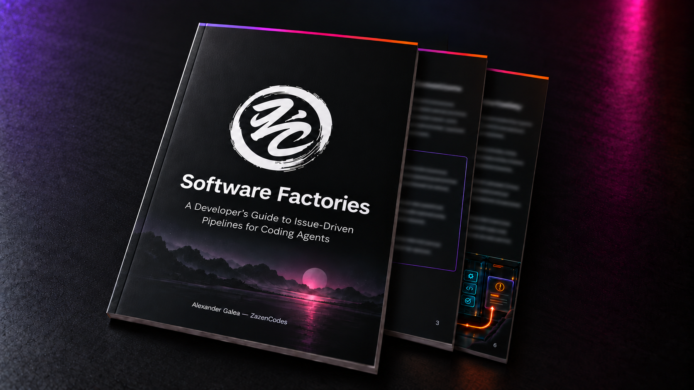

# Software Factory for Claude Code (v3.1: initiatives)

A software factory that works through your GitHub issues. Label an issue
`factory`, run `/factory run`, and agents decide whether it's worth building,
write a spec, build it, test it with your own checks, review it, and open a
pull request that closes the issue. The approver merges what it's sure of and
hands you the rest.

## Install

Open Claude Code in your project and paste:

```text
Install this software factory in this project from the reference repository:

https://github.com/pablogore/software-factory
```

Your agent reads [`INSTALL.md`](INSTALL.md), copies the skill, agents, scripts
and dashboard, fills `factory/checks.sh` with your project's real test, lint,
typecheck and build commands, tailors the reviewers to your stack, creates the
GitHub labels, and checks that `checks.sh` passes on `main`.

You need Claude Code 2.1.257 or later, `python3`, and an authenticated
[`gh`](https://cli.github.com/) that can push to the repo.

## The loop

```
issues labeled `factory`
        │
        ▼
intake (sonnet) ─ NEEDS-INFO → asks the author on the issue, waits for a reply
        │         REJECT     → says why on the issue, removes the label
        ▼ ACCEPT, maybe rescoped (once per issue)
spec-writer MODE=initiative → vision.md, context.md, slices.md  (a small issue = 1 slice)
        ▼  the `next` slice becomes a job
spec-writer MODE=slice → spec.md (≤ 40 lines)  ─ specgate (script) rejects a bad spec, no build spent
        ▼
intake rates this slice → route (script) picks reviewers and models from config.json
        ▼
builder (opus) → commits, pushes, opens a draft PR "Refs #n" (the issue closes when the initiative is DONE)
                 (a spike writes findings.md instead: no PR, no reviewers, no merge)
        ▼            ▲
gate (script) ─FAIL──┤  factory/checks.sh; no reviewer runs on a failing build
        ▼ PASS       │
reviewers ─CHANGES───┘  code (haiku | sonnet), + ux & ui on UI changes, + security
        ▼ all PASS
approver (opus) ── APPROVE  → sync with main, gate again, gh pr merge
                │              ▼
                │   spec-writer MODE=replan → context.md, slices.md, replan.md
                │     CONTINUE → wait for your OK (checkpoint: every-slice) or start the next slice (auto)
                │     DONE → the initiative and its issue close · NEEDS-HUMAN → asks you
                └─ ESCALATE → PR ready for you, issue labeled factory:needs-human
```

An initiative is built in slices: small vertical increments that each deliver
visible value. Build one, merge it, see it, learn, replan. Only the next slice
is specified in detail. An issue that is already small is an initiative of one
slice and goes through as before, plus a replan that closes it.

One Claude Code session orchestrates every job, `concurrency` at a time
(default 3). Each job gets its own git worktree and branch. All state lives in
`factory/jobs/` and `factory/initiatives/`, so if the session dies, `/factory run`
picks every job back up.

## Commands

```
/factory run          drain the queue: every open `factory` issue, `concurrency` at a time; also resumes
/factory run <n>      one issue now
/factory <anything>   talk to the factory: ask about jobs, give feedback, file a feature
```

You approve by merging the PR on GitHub. After each merge the factory replans
and, by default, waits for you (`factory/bin/job checkpoint-ok <initiative>`)
before the next slice; `factory/bin/job set-checkpoint <initiative> auto` skips
the wait. To change an escalated PR, tell the factory what you want with
`/factory`: that is rework for the same builder. Start the comment with
`[direction]` (or use `factory/bin/job feedback <n> --direction`) when you want
something different: that goes to the replan. To drop a job that waits on you
or on its author, tell the factory to reject it. 

## The guide

This folder is the companion to **A Developer's Guide to Software Factories**,
a short PDF on how factories like this one work and how to run yours. I'll send
you a copy when you [sign up to my newsletter](https://zazencodes.com/newsletter?utm_source=github&utm_medium=referral&utm_campaign=software-factory-claude-code-v2).

<p align="center">
  <a href="https://zazencodes.com/newsletter?utm_source=github&utm_medium=referral&utm_campaign=software-factory-claude-code-v2">
    
  </a>
  <br>
  <a href="https://zazencodes.com/newsletter?utm_source=github&utm_medium=referral&utm_campaign=software-factory-claude-code-v2">Get the free PDF</a>
</p>

## What's in here

```
.claude/
  skills/factory/SKILL.md     the orchestrator: queue, concurrency, the pipeline
  agents/
    intake.md                 sonnet   worth building? at what scope? risk + surfaces (also rates each slice)
    spec-writer.md            opus     three modes: initiative (slices), slice (spec.md), replan
    builder.md                opus     code, commits, the PR, build.md
    reviewer-code.md          routed   correctness, simplicity, tests
    reviewer-security.md      opus     only when intake flags `security`
    reviewer-ux.md            sonnet   only when intake flags `ui`
    reviewer-ui.md            haiku    only when intake flags `ui`
    approver.md               opus     APPROVE or ESCALATE
factory/
  config.json                 concurrency, rounds, labels, routing, protected paths, prices
  checks.sh                   your repo's checks (the installer fills it in)
  bin/job                     the only writer of job.json; refuses illegal moves; merges
  bin/gate                    runs checks.sh in a job's worktree → round-N/checks.md
  bin/route                   risk + surfaces → the job's reviewers and models
  bin/specgate                checks spec.md (≤ 40 lines, 3–5 criteria, Valor, Demo) and slices.md
  initiatives/<id>/           vision.md, context.md, slices.md, replan.md, initiative.json (gitignored)
  dashboard.html              the board
examples/jobs/                finished jobs from a real run
INSTALL.md                    instructions for the installing agent
DESIGN.md                     how it works and why
```

[`DESIGN.md`](DESIGN.md) explains each decision and lists what changed from
[v1](../software-factory-claude-code).

## Dashboard

```bash
cd factory && python3 -m http.server
```

Open <http://localhost:8000/dashboard.html>. Above the board, each initiative
lists its slices with their state and job, and the latest Changelog line of its
`context.md`. Each job is a card with its issue
and PR, a row of gate and review chips per round, its risk, cost and
time. Click a card to read every file the job wrote; each one opens with a
short summary of what happened in that step. To see the example
jobs, copy `examples/jobs/` to `factory/jobs/` first.

Cost is the API-equivalent price of each job's agents, read from Claude Code's
transcripts. On a subscription plan it shows where the spend goes, not what
you're billed.

## The example jobs

They come from a test run on a small private calculator repo, with
`concurrency: 2` and every agent on Haiku to keep it cheap.

- **001-add-a-subtract-function**: low risk, no UI, so only the code reviewer
  ran. Approved and merged through its PR.
- **002-show-a-history-of**: a UI change, so the UX and UI reviewers ran too.
  Merged.
- **003-add-multiply-divide-power**: intake cut an oversized "scientific
  calculator" issue down to three functions. The gate failed round 1 because
  the builder edited a protected test file, and the job went to a human after
  three rounds.
- **005-add-a-crypto-miner**: rejected at intake.

## Cost and safety

- It opens and merges real PRs and runs on your Claude plan. Start with
  `concurrency: 1` and read every PR until you trust it.
- Intake runs on Fable once per issue. Depending on your plan, Fable can bill
  to usage credits rather than your plan's included usage.
- Only issues labeled `factory` run, and only people with triage or write
  access can add labels. Issue text reaches the agents as quoted data, never
  as their instructions.
- The factory pushes only `factory/*` branches, merges only through
  `gh pr merge`, and never deploys.

## More from ZazenCodes

- **Agentic Coding Fundamentals**, the full course:
  <https://zazencodes.com/courses/agentic-coding-fundamentals>
- **Newsletter**, one email a week: <https://zazencodes.com/newsletter>
- **YouTube**: <https://youtube.com/@ZazenCodes>

## License

[GPLv3](LICENSE). You can use, modify and share this code, and any version you
distribute must also be released under GPLv3.

Want to use this in closed-source or commercial software? Get in touch for a commercial license.

<p align="center">
  <a href="https://zazencodes.com/?utm_source=github&utm_medium=referral&utm_campaign=software-factory-claude-code-v2">
    
  </a>
  <br>
  Created by <a href="https://zazencodes.com/">ZazenCodes</a>
</p>
