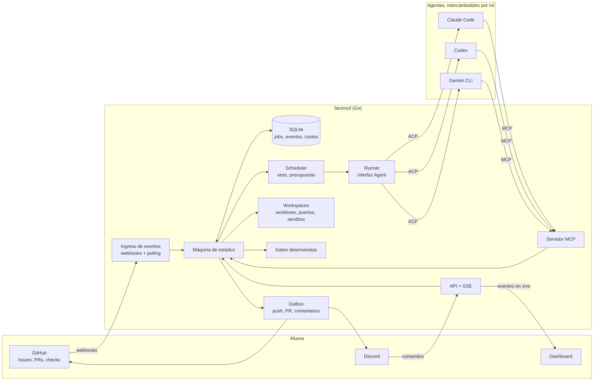
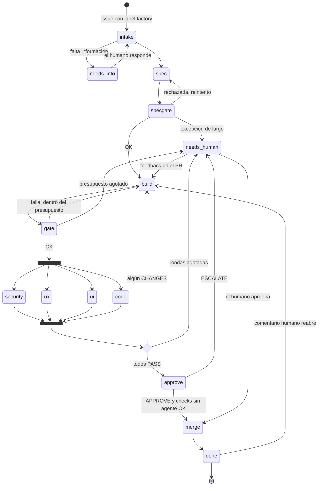
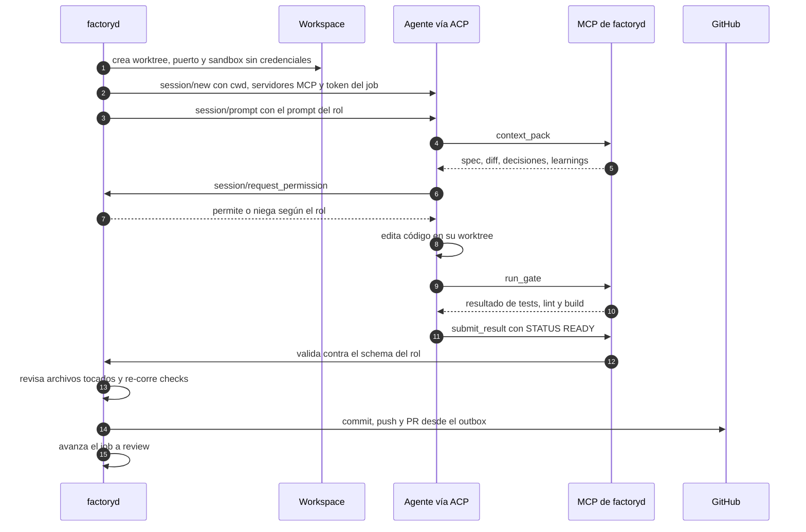
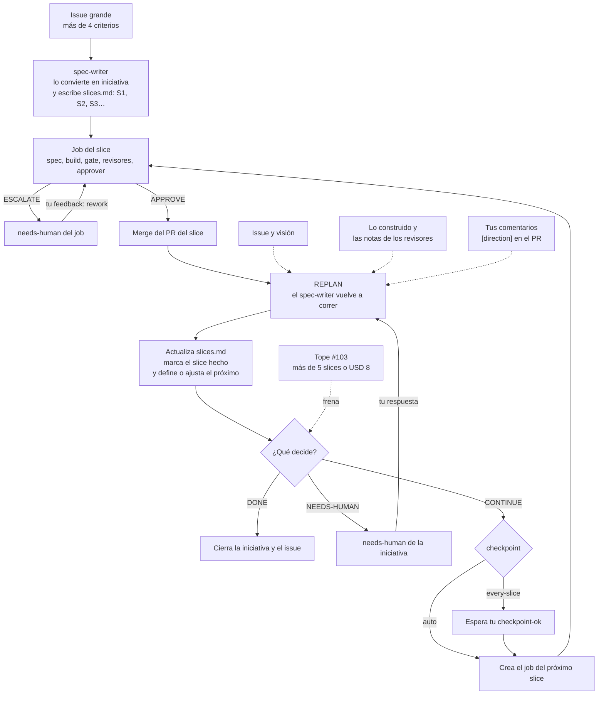

# factoryd: diagramas del flujo

### 1. Arquitectura

### 2. Vida de un job

### 3. Una etapa por dentro (builder)

### 4. Iniciativas y replan
Las specs son cortas (1 a 4 criterios). Cuando un issue pide más, el spec-writer lo convierte en una **iniciativa** y lo parte en **slices**: cada slice es un job con su propio PR. Después de cada merge corre el **replan**: el spec-writer lee el issue, lo construido, las notas de los revisores y los comentarios `[direction]`, actualiza `slices.md` y decide:

| Decisión | Qué significa | Qué pasa |
|---|---|---|
| CONTINUE | Falta trabajo; el próximo slice ya está definido | `every-slice`: espera `checkpoint-ok`. `auto`: arranca solo. |
| DONE | El issue está cumplido | Se cierran la iniciativa y el issue. |
| NEEDS-HUMAN | Hay una decisión que no puede tomar | Pregunta; la respuesta vuelve al replan. |

No hay que confundirlo con el **rework** (un ESCALATE o los cambios pedidos vuelven al builder del mismo PR) ni con el **triage** (el tech-lead destraba un job contra una pared). El tope de #103 (más de 5 slices o USD 8 por issue) evita que el replan agregue slices sin fin.

