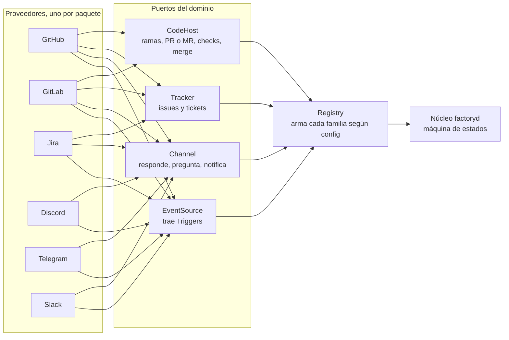
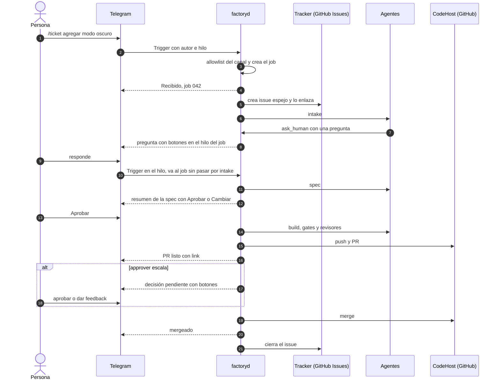

# factoryd: integraciones (canales, trackers y code hosts)

Fecha: 2026-11-05. Decisión de Pablo: Discord y Telegram (y otros chats) no solo notifican, también **inician** trabajo: se manda un ticket y la fábrica arma todo. GitHub deja de ser "la" integración y pasa a ser **la primera** de una familia abstracta.

## Modelo (tomado en parte de dsh-superagent)
- **Proveedor**: un paquete por servicio (github, gitlab, jira, discord, telegram, slack…). Implementa solo las capacidades que tiene.
- **Capacidades (puertos del dominio)**:
  - `EventSource`: trae Triggers (mensaje, comando, comentario, review, check) con autor e hilo.
  - `Channel`: escribe en un hilo: responder, preguntar con botones, notificar, adjuntar.
  - `Tracker`: issues/tickets: crear, leer, comentar, labels/estado, cerrar.
  - `CodeHost`: ramas, push, PR/MR, reviews, checks, merge.
- **Registry** (estilo `database/sql`): cada proveedor se registra en `init()`; la config de cada proyecto elige qué proveedor cubre cada capacidad. Eso es la abstract factory: el proyecto pide "la familia" y el registry la arma.
- **El núcleo solo ve los puertos.** Nunca importa `github`, `discord`, etc.

| Proveedor | EventSource | Channel | Tracker | CodeHost |
|---|---|---|---|---|
| GitHub (primero) | ✓ | ✓ (comentarios) | ✓ | ✓ |
| GitLab | ✓ | ✓ | ✓ | ✓ |
| Jira / Linear | ✓ | ✓ | ✓ | |
| Discord | ✓ | ✓ | | |
| Telegram | ✓ | ✓ | | |
| Slack | ✓ | ✓ | | |

## Interfaces en Go (borrador)
```go
type Provider interface {
    ID() string
}
// Capacidades opcionales: se descubren con type assertion.
type SourceProvider   interface { Source(cfg Config) (EventSource, error) }
type ChannelProvider  interface { Channel(cfg Config) (Channel, error) }
type TrackerProvider  interface { Tracker(cfg Config) (Tracker, error) }
type CodeHostProvider interface { CodeHost(cfg Config) (CodeHost, error) }

type Trigger struct {
    Provider string    // "telegram"
    Thread   ThreadRef // chat+topic, issue, PR…
    Actor    Actor     // id en ESE proveedor; nunca se mapea entre proveedores
    Kind     string    // command, message, comment, review, check
    Text     string
    At       time.Time
}

type EventSource interface { Run(ctx context.Context, out chan<- Trigger) error }
type Channel interface {
    Reply(ctx context.Context, t ThreadRef, m Message) (MsgRef, error)
    Ask(ctx context.Context, t ThreadRef, q Question) (MsgRef, error) // botones / opciones
    OpenThread(ctx context.Context, parent ThreadRef, title string) (ThreadRef, error) // hilo por job
}
type Tracker interface {
    Create(ctx context.Context, it Item) (ItemRef, error)
    Get(ctx context.Context, r ItemRef) (Item, error)
    Comment(ctx context.Context, r ItemRef, body string) error
    SetState(ctx context.Context, r ItemRef, s ItemState) error
}
type CodeHost interface {
    Push(ctx context.Context, repo RepoRef, branch string) error
    OpenChange(ctx context.Context, c Change) (ChangeRef, error) // PR o MR
    ChangeStatus(ctx context.Context, r ChangeRef) (ChangeStatus, error)
    Merge(ctx context.Context, r ChangeRef, sha string) error // solo el SHA revisado
}

func Register(p Provider)               // en init() de cada paquete
func Build(cfg ProjectConfig) (*Family, error) // arma Source/Channel/Tracker/CodeHost del proyecto
```

## Config por proyecto (ejemplo)
```yaml
project: verimand
code_host: github:pablogore/verimand
tracker: github            # mañana: jira:VER o linear:ENG
mirror_chat_tickets: true  # un ticket de chat crea issue espejo en el tracker
channels:
  - provider: telegram
    chat: -100123456
    allow: [111111111]                 # ids de Telegram
  - provider: discord
    guild: 999
    channel: factory
    allow: ["222222222222222222"]      # ids de Discord
notify: [origin]           # avisar en el hilo donde nació el ticket
```

## Job y origen
- El job es interno de factoryd. Guarda: **origen** (proveedor + hilo + autor), **espejo** en el tracker (opcional) y **cambio** en el code host.
- **Suscripciones**: el job queda suscripto a sus hilos (chat, issue, PR). Un mensaje de una persona permitida en cualquiera de ellos entra al job como feedback, sin pasar de nuevo por intake. Un job cerrado se reabre igual.
- Se responde en el hilo donde se pidió. En Discord se abre un hilo por job; en Telegram, un tema (forum topic) o cadena de respuestas.

## Reglas de entrada (seguridad)
- **Crear trabajo solo con comando explícito** (`/ticket`, `/hacer`) o mención al bot. Texto libre fuera del hilo de un job no ejecuta nada.
- **Allowlist por proveedor, con su propia identidad.** Un id de Telegram nunca se traduce a uno de GitHub.
- El texto del ticket se pasa a los agentes como dato citado, igual que `issue.md`.
- Aprobaciones sensibles (merge, excepción de largo, escalado) con botones, y solo de autores permitidos en ese canal.
- Ver `control-remoto-discord.md`: 2FA obligatorio; Discord suma la barrera de servidor compartido.

## Orden sugerido
1. Definir puertos + registry + `Family` con GitHub como único proveedor (lo que ya hace la fábrica).
2. Telegram o Discord como `EventSource` + `Channel`: `/ticket`, hilo por job, preguntas con botones, avisos.
3. Issue espejo opcional y suscripciones multi-hilo.
4. Segundo code host (GitLab) para probar que el núcleo no sabe de GitHub.
5. Jira/Linear como tracker.

## Diagramas
### Abstract factory de integraciones


### Un ticket que nace en Telegram

