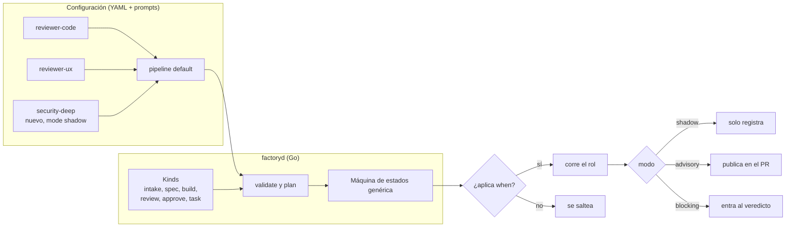

# factoryd: roles y flujo dinámicos

Fecha: 2026-11-05. Pedido de Pablo: poder agregar roles nuevos sin tocar código (ej. un revisor especialista en seguridad) y asociarlos al flujo y a una fábrica.

## Idea: Go define los *tipos*, la configuración define los *roles* y el *flujo*
- **Tipo de rol (kind)**: lo programa Go. Define qué recibe, qué schema de `submit_result` devuelve y qué hace la máquina de estados con ese resultado. Pocos y estables:

| Kind | Devuelve | Efecto en el flujo |
|---|---|---|
| `intake` | ACCEPT / NEEDS_INFO / REJECT + slices | arranca, pregunta o descarta |
| `spec` | spec estructurada | pasa por specgate |
| `build` | READY / BLOCKED + resumen | pasa por gate determinista |
| `review` | PASS / CHANGES + hallazgos (archivo:línea, severidad) | vuelve a build o sigue |
| `approve` | APPROVE / ESCALATE + motivos | merge o needs-human |
| `task` | archivos declarados en `produces` + checks `verify` (estilo apmx) | genérico: docs, changelog, migración propuesta, preview… |

- **Rol**: una instancia de un kind, en YAML + un prompt `.md`. Agregar un rol de un kind existente **no requiere código**.
- **Flujo (pipeline)**: también en YAML. Lista de etapas; cada etapa referencia roles y puede tener varios en paralelo. Go lo valida y lo ejecuta con la misma máquina de estados genérica.

## Ejemplo: revisor especialista en seguridad
`roles/security-deep.yaml`
```yaml
name: security-deep
kind: review
description: Revisión profunda de auth, sesiones, permisos y dependencias
prompt: roles/security-deep.md
agent: codex            # o claude, gemini…; distinto del builder para no autoaprobarse
model: gpt-5.5
when:                   # cuándo corre; si no aplica, se saltea sin costo
  any:
    - paths: ["src/auth/**", "src/api/**", "**/middleware/**"]
    - labels: [security, auth, payments]
    - deps_changed: true
    - diff_lines: ">= 200"
mode: shadow            # shadow → advisory → blocking
tools: [context_pack, submit_result]
permissions: read-only  # sandbox de solo lectura del worktree
budget: { attempts: 1, minutes: 15, usd: 2 }
```
`pipelines/default.yaml`
```yaml
name: default
stages:
  - intake
  - spec
  - build
  - review:
      parallel: [reviewer-security, reviewer-ux, reviewer-ui, reviewer-code, security-deep]
      on_changes: build
      max_rounds: 3
  - approve
```
Y en la fábrica (`factory.yaml` o `.factory/` del repo): `pipeline: default`. Otra fábrica puede usar `pipeline: backend` sin ux/ui.

### Cuándo corre un rol (`when`)
Un rol de review con `when` corre si se cumple al menos una de las condiciones de `any` y se cumplen todas las de `all`; dentro de una condición, tienen que cumplirse todas sus claves. Si un rol pone las dos, tienen que cumplirse las dos. Si no se cumplen, el rol se saltea en esa ronda y el historial del job registra el rol, la ronda y el motivo.

```yaml
when:
  any:
    - risk: [high]                 # el riesgo del intake está en la lista
    - surfaces: [auth, payments]   # el intake comparte al menos una superficie
    - paths: ["src/auth/**"]       # algún archivo cambiado coincide
    - diff_lines: ">= 200"         # tamaño del diff (líneas agregadas más borradas)
```

```yaml
when:
  all:                             # corre solo con riesgo alto y si toca auth
    - risk: [high]
    - surfaces: [auth]
```

Las claves de una condición son las mismas en `any` y en `all`.

- `risk`: lista de `low`, `medium` o `high`; otro valor es error de validación. Si el intake no dejó riesgo (jobs aceptados antes de que lo pidiera), cuenta como `high`, así el revisor corre en vez de saltearse.
- `surfaces`: nombres libres, comparados exactos con los del intake. Un intake que dijo que no hay superficies (`[]`) no comparte ninguna. Si el intake no dejó riesgo, tampoco calificó superficies y la condición cuenta como que aplica.
- `labels` y `deps_changed` todavía no se evalúan: cuentan como que aplica. `paths` y `diff_lines` también aplican cuando el gate no pudo leer el diff.

### Campos de intake (`risk`, `surfaces`)
Un intake ACCEPT devuelve en `submit_result`, además de la decisión, su calificación del job:

```json
{"decision": "ACCEPT", "risk": "medium", "surfaces": ["api", "auth"]}
```

- `risk`: `low`, `medium` o `high`; obligatorio en un ACCEPT.
- `surfaces`: lista de nombres libres de las partes del producto que toca (por ejemplo `ui`, `auth`, `payments`); `[]` cuando no hay ninguna. Obligatoria en un ACCEPT: no decir nada se rechaza, y un nombre en blanco es inválido.
- NEEDS_INFO y REJECT no los piden.
- El job guarda los dos y el `when` de los roles los lee con `risk` y `surfaces`.

### Archivos que puede tocar un builder (`allowed_paths`)
Un rol `build` puede declarar los únicos archivos que su diff puede agregar, modificar o borrar, relativos a la raíz del repo. Una entrada que termina en `/` cubre todo lo que está debajo; cualquier otra es un patrón de `path.Match` (por ejemplo `internal/slices/*.go`).

```yaml
name: builder-store
kind: build
allowed_paths:
  - internal/adapters/out/sqlite/
  - internal/ports/store.go
```

- Sin `allowed_paths`, el builder no tiene límite de archivos (los paths protegidos siguen valiendo igual).
- Solo los roles `build` lo aceptan; en otro kind es error de validación.
- El gate falla nombrando cada archivo fuera de lo permitido, aunque los checks pasen. Los archivos nuevos sin trackear cuentan como tocados.
- Es aparte de los **paths protegidos**, que son fijos en factoryd y no se leen de la rama: `Makefile` (y `GNUmakefile`, `makefile`), `internal/arch_test.go`, todo `.github/`, `AGENTS.md`, `.golangci.yml` y `docs/factoryd/0*.md`. En `.github/` no se puede agregar, modificar ni borrar; en los demás, agregar un archivo nuevo está permitido.

### Límites de reintento (`limits`)
Un pipeline puede fijar cuántas veces se reintenta cada cosa antes de que el job pase a una persona. Todos son opcionales y, si se ponen, valen al menos 1 (también `attempt_retries`), salvo `triage_retries`, que puede ser 0; una clave desconocida en `limits` es un error.

```yaml
name: default
limits:
  spec_rejections: 3   # rechazos de specgate antes de needs-human (por defecto 3)
  human_reworks: 1     # retrabajos desde needs-human que vuelven a build (sin límite si no se pone, o "unlimited")
  triage_retries: 1    # reintentos que el triage puede dar a un job trabado (0 = sin triage: la pared va directo a una persona)
  max_rounds: 3        # rondas de un review que no fija las suyas (por defecto 3)
  attempt_retries: 1   # reintentos con sesión nueva de un intento fallido, por etapa y ronda (por defecto 1, al menos 1)
stages:
  - intake
  - spec
  - build
  - review:
      parallel: [reviewer-code]
      on_changes: build    # sin max_rounds: usa limits.max_rounds
  - approve
```

- **Rondas:** un review usa su propio `max_rounds`; si no lo tiene, `limits.max_rounds`; si tampoco, 3. Un gate fallido gasta una ronda igual que un CHANGES.
- **`human_reworks` nunca se reinicia.** Cuenta solo el feedback desde needs-human que devuelve el job a build. No cuentan el que lo devuelve a spec (excepción de largo, escalada de specgate), porque ese ciclo ya lo limita `spec_rejections`, ni reabrir un job mergeado (un comentario en done). Cuando se agota, en needs-human solo se puede aprobar, rechazar o detener.
- **Triage:** cuando un job choca contra una pared (gate fallido sin rondas, rondas agotadas, BLOCKED del builder o merge fallido), corre el rol `tech-lead`, que devuelve RETRY (vuelve al builder con instrucciones y suma una ronda) o ESCALATE (needs-human con una pregunta cerrada). Agotados los `triage_retries`, la pared siguiente escala sin triage. Un ESCALATE del approver y una acción externa rechazada van directo a una persona. Un intento fallido que agotó sus `attempt_retries` también es una pared, con causa `attempt-failed`.
- **Un rework humano no da rondas nuevas:** el job vuelve a build en la misma ronda. Si esa era la última, un nuevo CHANGES lo devuelve a needs-human.

## Modos de un rol nuevo (para meterlo sin riesgo)
1. **shadow**: corre y registra hallazgos, pero nadie los ve en el PR ni frenan nada. Sirve para medir costo y si encuentra cosas útiles.
2. **advisory**: sus hallazgos se publican en el PR y los lee el approver, pero un CHANGES no bloquea.
3. **blocking**: participa del veredicto como cualquier revisor.
Las métricas por rol (costo, hallazgos, cuántos terminaron en cambios reales, falsos positivos marcados por humanos) deciden cuándo promoverlo.

## Validación (`factory config validate` / `plan`)
- Pipeline es un DAG; hay exactamente un `build` por job; todo `review` tiene a dónde volver.
- Los nombres de etapa son únicos.
- **Orden:** el build va antes de cualquier review, toda review va antes del approve, hay exactamente un approve, y después del approve solo puede haber etapas de kind `task`. Una etapa de otro kind entre la review y el approve se acepta.
- **Roles de cada etapa:** una etapa que no lista roles toma el rol por defecto de su kind; ninguna etapa queda sin rol. Cada rol listado tiene el kind de su etapa y aparece en una sola etapa (así un builder no puede aprobar su propio trabajo), y un rol repetido en la misma etapa es error.
- **Nombres de rol:** minúsculas, dígitos y guiones; se comparan exactos. En `Decide`, el resultado de un rol que no es de la etapa en curso es una transición ilegal.
- Conocido: un `~` o `null` dentro de `parallel` se descarta sin error al cargar.
- Todo `review` lista al menos un rol (`parallel`); su `max_rounds`, si lo fija, es >= 1.
- Los valores de `limits` que se fijan son >= 1, también `attempt_retries` (`triage_retries` puede ser 0), y una clave desconocida en `limits` es un error.
- Topes: `max_rounds` (en `limits` o en una etapa de review), `spec_rejections` y `human_reworks` <= 10; `triage_retries` y `attempt_retries` <= 3. `human_reworks: unlimited` sigue siendo válido. Un override por job puede llegar hasta 20 (5 para `triage_retries` y `attempt_retries`) y queda registrado con quién lo pidió.
- Ninguna etapa, sea del kind que sea, se llama como un estado del job: `stopped`, `merge`, `needs-human`, `needs-info`, `done`, `rejected`, `triage`. El error nombra la etapa.
- El schema del kind existe y el prompt no está vacío.
- El agente y el modelo existen en la config; las tools pedidas están permitidas para ese kind.
- `plan` muestra el impacto: "security-deep habría corrido en 7 de los últimos 20 jobs, costo estimado X".
- Agregar o cambiar roles y pipelines es **cambio sensible**: va por PR al repo de configuración y requiere aprobación (ver `factoryd-config.md`).

## Lo genérico que eso exige del núcleo
- El approver recibe **todos** los resultados de review como lista genérica (rol, modo, veredicto, hallazgos), no campos fijos por revisor.
- Hallazgos con forma común (`archivo:línea`, severidad, categoría, rol) → memoria entre rondas y dashboard sirven para cualquier rol.
- En rondas ≥ 2 solo re-corren los roles que pidieron CHANGES, más los que marquen `always_rerun`.
- Kind nuevo (algo que no encaja en los seis) = código Go + schema. Antes, probar si entra como `task`.

## Catálogo de roles compartidos (más adelante)
- Importar roles desde un repo (`factory role add github:org/roles//security-deep@v1.2`), con versión fijada y digest registrado en cada job.
- Tratarlos como dependencia de la cadena de suministro (idea de apmx): revisar antes de actualizar, nunca auto-actualizar.

## Diagrama


## Orden sugerido
1. Kinds fijos en Go + roles actuales pasados a YAML (paridad con hoy).
2. Pipeline en YAML con etapas paralelas y `when`.
3. Modos shadow/advisory/blocking + métricas por rol.
4. Kind `task` con `produces`/`verify`.
5. Catálogo de roles importables con versión y digest.
