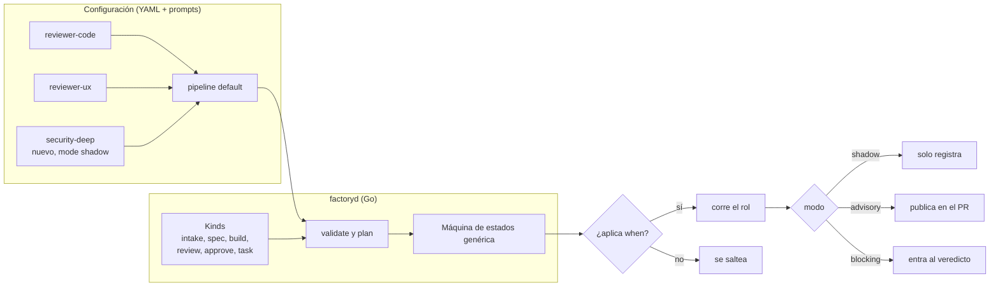

# factoryd: roles y flujo dinámicos

Fecha: 2026-11-05. Pedido de Pablo: poder agregar roles nuevos sin tocar código (ej. un revisor especialista en seguridad) y asociarlos al flujo y a una fábrica.

## Idea: Go define los *tipos*, la configuración define los *roles* y el *flujo*
- **Tipo de rol (kind)**: lo programa Go. Define qué recibe, qué schema de `submit_result` devuelve y qué hace la máquina de estados con ese resultado. Pocos y estables:

| Kind | Devuelve | Efecto en el flujo |
|---|---|---|
| `intake` | ACCEPT / NEEDS_INFO / REJECT + slices | arranca, pregunta o descarta |
| `spec` | spec estructurada | pasa por specgate |
| `build` | READY / BLOCKED + resumen | pasa por gate determinista |
| `review` | PASS / CHANGES + hallazgos (archivo:línea, severidad) | vuelve a build o sigue |
| `approve` | APPROVE / ESCALATE + motivos | merge o needs-human |
| `task` | archivos declarados en `produces` + checks `verify` (estilo apmx) | genérico: docs, changelog, migración propuesta, preview… |

- **Rol**: una instancia de un kind, en YAML + un prompt `.md`. Agregar un rol de un kind existente **no requiere código**.
- **Flujo (pipeline)**: también en YAML. Lista de etapas; cada etapa referencia roles y puede tener varios en paralelo. Go lo valida y lo ejecuta con la misma máquina de estados genérica.

## Ejemplo: revisor especialista en seguridad
`roles/security-deep.yaml`
```yaml
name: security-deep
kind: review
description: Revisión profunda de auth, sesiones, permisos y dependencias
prompt: roles/security-deep.md
agent: codex            # o claude, gemini…; distinto del builder para no autoaprobarse
model: gpt-5.5
when:                   # cuándo corre; si no aplica, se saltea sin costo
  any:
    - paths: ["src/auth/**", "src/api/**", "**/middleware/**"]
    - labels: [security, auth, payments]
    - deps_changed: true
    - diff_lines: ">= 200"
mode: shadow            # shadow → advisory → blocking
tools: [context_pack, record_finding, submit_result]
permissions: read-only  # sandbox de solo lectura del worktree
budget: { attempts: 1, minutes: 15, usd: 2 }
```
`pipelines/default.yaml`
```yaml
name: default
stages:
  - intake
  - spec
  - build
  - review:
      parallel: [reviewer-security, reviewer-ux, reviewer-ui, reviewer-code, security-deep]
      on_changes: build
      max_rounds: 3
  - approve
```
Y en la fábrica (`factory.yaml` o `.factory/` del repo): `pipeline: default`. Otra fábrica puede usar `pipeline: backend` sin ux/ui.

## Modos de un rol nuevo (para meterlo sin riesgo)
1. **shadow**: corre y registra hallazgos, pero nadie los ve en el PR ni frenan nada. Sirve para medir costo y si encuentra cosas útiles.
2. **advisory**: sus hallazgos se publican en el PR y los lee el approver, pero un CHANGES no bloquea.
3. **blocking**: participa del veredicto como cualquier revisor.
Las métricas por rol (costo, hallazgos, cuántos terminaron en cambios reales, falsos positivos marcados por humanos) deciden cuándo promoverlo.

## Validación (`factory config validate` / `plan`)
- Pipeline es un DAG; hay exactamente un `build` por job; todo `review` tiene a dónde volver.
- Los nombres de etapa son únicos.
- Todo `review` lista al menos un rol (`parallel`) y tiene `max_rounds` >= 1.
- Ninguna etapa, sea del kind que sea, se llama como un estado del job: `stopped`, `merge`, `needs-human`, `needs-info`, `done`, `rejected`. El error nombra la etapa.
- El schema del kind existe y el prompt no está vacío.
- El agente y el modelo existen en la config; las tools pedidas están permitidas para ese kind.
- `plan` muestra el impacto: "security-deep habría corrido en 7 de los últimos 20 jobs, costo estimado X".
- Agregar o cambiar roles y pipelines es **cambio sensible**: va por PR al repo de configuración y requiere aprobación (ver `factoryd-config.md`).

## Lo genérico que eso exige del núcleo
- El approver recibe **todos** los resultados de review como lista genérica (rol, modo, veredicto, hallazgos), no campos fijos por revisor.
- Hallazgos con forma común (`archivo:línea`, severidad, categoría, rol) → memoria entre rondas y dashboard sirven para cualquier rol.
- En rondas ≥ 2 solo re-corren los roles que pidieron CHANGES, más los que marquen `always_rerun`.
- Kind nuevo (algo que no encaja en los seis) = código Go + schema. Antes, probar si entra como `task`.

## Catálogo de roles compartidos (más adelante)
- Importar roles desde un repo (`factory role add github:org/roles//security-deep@v1.2`), con versión fijada y digest registrado en cada job.
- Tratarlos como dependencia de la cadena de suministro (idea de apmx): revisar antes de actualizar, nunca auto-actualizar.

## Diagrama


## Orden sugerido
1. Kinds fijos en Go + roles actuales pasados a YAML (paridad con hoy).
2. Pipeline en YAML con etapas paralelas y `when`.
3. Modos shadow/advisory/blocking + métricas por rol.
4. Kind `task` con `produces`/`verify`.
5. Catálogo de roles importables con versión y digest.
