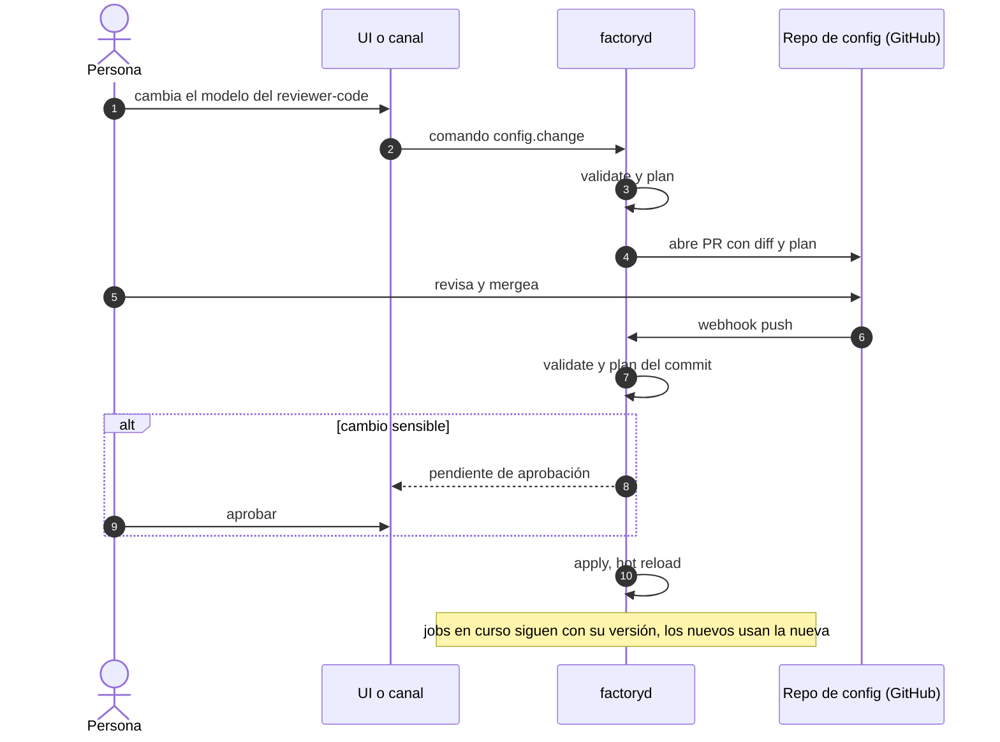

# factoryd: configuración como código (exportar, importar, sincronizar)

Fecha: 2026-11-05. Pedido de Pablo: exportar e importar la configuración, y sincronizarla con GitHub.

## Principio
- **La configuración es un conjunto de archivos YAML declarativos, versionables.** La base de datos guarda el estado de los jobs, no la configuración: la configuración vigente es siempre "el último commit aplicado" más overrides locales.
- **Los secretos nunca se exportan.** En los archivos solo hay referencias (`secret://telegram/bot_token`); el valor vive en el llavero del sistema, variables de entorno o un gestor (1Password, Vault, sops/age).
- **Sincronizar con GitHub usa el puerto `CodeHost`**: GitHub es el primero, pero sirve igual con GitLab o cualquier remoto git.
- **Cada job registra la versión de configuración con la que corrió** (commit + digest), como el Mandate de dsh-superagent y el digest de fábrica de apmx. Los jobs en curso siguen con su versión; los nuevos toman la nueva.

## Qué se exporta
| Archivo | Contenido | Sensible |
|---|---|---|
| `factory.yaml` | proyecto, code host, tracker, base branch, concurrencia, presupuestos | no |
| `providers.yaml` | canales (ids de chat/servidor), allowlists por proveedor | ids de personas: repo privado |
| `roles.yaml` | rol → agente, modelo, herramientas MCP, límites | no |
| `roles/*.md` | prompts de rol | no |
| `gates.yaml` | checks, paths protegidos, reglas de escalado, merge policy | no |
| `secrets.yaml` | solo referencias a secretos | no (sin valores) |

No se exporta: estado de jobs, tokens, sesiones, costos (eso es otro export: `factory jobs export`).

**Credenciales y HOME del agente.** El agente y el gate no heredan el entorno de factoryd: reciben solo una lista blanca (`PATH`, locale, `TMPDIR`, cachés de Go). Cada agente de `roles.yaml` puede declarar `env_passthrough`, una lista de *nombres* de variables (p. ej. `OPENAI_API_KEY`) que se copian tal cual del entorno de factoryd; la config nunca lleva valores, y `factoryd config-validate` rechaza ahí `GITHUB_TOKEN`, `GH_TOKEN` y los tokens de canales. El agente y el gate usan un HOME propio por job, en el directorio de datos de factoryd, fuera del worktree y separado del de los otros jobs. Un agente con `home: user` corre en cambio con el HOME del usuario, para los que inician sesión con su cuenta (como Claude Code con suscripción): hasta que exista el sandbox (E04.2), eso le da al agente acceso a la carpeta del usuario.

**Opciones de `factoryd serve`.**
- `--config <carpeta>` (por defecto `.`): la raíz de la configuración, con `roles.yaml`, `roles/` y `pipelines/`.
- `--store <archivo>` (obligatorio, sin valor por defecto): el archivo SQLite donde se guardan los jobs y sus eventos. Sin él, `serve` no arranca.
- `--repo <carpeta>` (por defecto `.`): el repo git donde se crean los worktrees de los jobs.
- `--base <rama>` (por defecto `main`): la rama de la que parten los worktrees de los jobs.
- `--dev-state <carpeta>` (por defecto `factoryd/devservers` dentro de la caché del usuario): dónde se anotan los dev servers que corren, para que el próximo arranque mate los que dejó una caída.
- `--concurrency <n>` (por defecto `1`): cuántos agentes corren a la vez; debe ser al menos 1.
- `--budget <USD>` (por defecto `0`): cuánto puede gastar un job, salvo que una persona le haya subido el suyo. Debe ser mayor que 0: con el valor por defecto `serve` no arranca, así que hay que pasarlo siempre.
- `--costs <fuente>` (por defecto ninguna): de dónde sale lo que gasta un job. `subscription` cuenta 0 USD (agentes pagados por suscripción, no por uso), así que el presupuesto nunca corta un job. Sin fuente declarada, `serve` no lanza ningún agente, en vez de correr uno sin límite de gasto. Cualquier otra fuente hace que `serve` no arranque.
- `--listen <dirección>` (por defecto `127.0.0.1:7317`): dónde escuchan la API del trabajador y el MCP de cada job, a los que se conectan las sesiones de los agentes. Si la dirección no es local (loopback), `serve` arranca igual pero muestra un aviso que la nombra: otras máquinas podrían llegar a la API y a los MCP de los jobs.
- `--session-timeout <duración>` (por defecto `2h`): cuánto puede correr la sesión de un rol antes de que se corte y su intento falle.
- `--tick <duración>` (por defecto `1s`): cada cuánto se despachan los reintentos que vencieron y el outbox.
- `--shutdown-grace <duración>` (por defecto `30s`): cuánto espera un apagado a lo que está corriendo antes de cancelarlo.

Las tres duraciones deben ser mayores que 0.

## Capas y precedencia
1. Valores por defecto del binario.
2. **Global** (repo central de configuración, ej. `pablogore/factory-config`): proveedores, roles, prompts, presupuestos.
3. **Por repo** (`.factory/` dentro de cada repo de código): gates, comandos de test/build, paths protegidos, overrides de roles. Se revisa junto con el código.
4. **Local** (`~/.config/factory/local.yaml`): puertos, rutas, overrides de la máquina. Nunca se sincroniza.

## Comandos
```text
factory config export [--out dir | --tar file] [--include-local]
factory config import <dir|file|git-url> [--dry-run]
factory config validate                # JSON Schema + referencias (secretos, proveedores, agentes)
factory config plan                    # diff entre lo vigente y lo que se aplicaría
factory config apply                   # aplica; hot reload sin cortar jobs
factory config sync status|pull|push   # contra el remoto configurado
```
- `import` y `pull` siempre pasan por `validate` + `plan`; si hay cambios sensibles, piden confirmación.
- En la UI (desktop/web/TUI) se ve el plan antes de aplicar; las ediciones hechas en la UI se guardan como cambio pendiente, no directo.

## Sincronización con GitHub
- **Pull**: webhook de `push` al repo de configuración (o polling) → `validate` → `plan` → aplica si no hay cambios sensibles; si los hay, queda pendiente de aprobación en "Te necesita" y en los canales.
- **Push**: un cambio hecho desde la UI o un canal no se escribe en `main`: factoryd abre un **PR al repo de configuración** con el diff y el plan en la descripción. Al mergear, vuelve por el pull. Git es la única fuente de verdad, sin conflictos de dos escritores.
- **Drift**: si la configuración aplicada no coincide con el commit remoto (edición local, apply manual), se marca en el panel y `sync status` lo muestra.

## Cambios sensibles (requieren aprobación humana explícita)
- Allowlists, quién puede aprobar o mergear.
- Merge policy, paths protegidos, reglas de escalado.
- Herramientas, permisos o sandbox de un rol; agregar un agente o proveedor nuevo.
- Referencias a secretos.

Los agentes de la fábrica **nunca** pueden modificar el repo de configuración ni `.factory/` (path protegido en el gate y fuera de su sandbox).

## Diagrama


## Orden sugerido
1. Schema de los YAML + `validate` / `plan` / `apply` con archivos locales.
2. `export` / `import` (directorio, tar y URL git).
3. Referencias de secretos con llavero del sistema y variables de entorno.
4. Pull desde GitHub por webhook/polling con detección de drift.
5. Push como PR desde la UI y los canales; aprobación de cambios sensibles.
