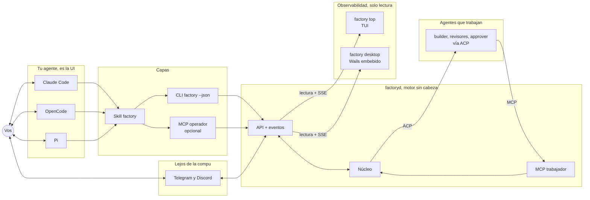

# factoryd: se maneja desde el agente, se observa desde TUI y desktop

Fecha: 2026-11-05. Decisiones de Pablo: la experiencia tiene que ser distinta a AO (Composio Agent Orchestrator: dashboard web en localhost:3000 con tablero kanban, app de escritorio, CLI). **Todo lo que es operar** (pedir, aprobar, dar feedback, configurar) **sale del agente** que uno ya usa (Claude Code, OpenCode, Pi, Codex…). **La TUI y la desktop quedan, pero solo para observabilidad**, como el dashboard de hoy.

## Principio
- **factoryd es un motor sin cabeza.** Expone una API y la fábrica se maneja conversando con tu agente: "¿qué me necesita?", "mostrame el job 42", "aprobá la spec", "agregá un revisor de seguridad en shadow".
- **El agente es la UI**: resume, arma tablas, dibuja Mermaid, muestra diffs, abre archivos, con lo que cada agente ya sabe renderizar.
- **Una capa común para todos los agentes, y extras opcionales por agente.**
- Cuando no estás frente al agente, avisan los canales (Discord, Telegram) con botones: siguen siendo "agente" en el sentido de conversación, no un front.

## Capas de integración con el agente del humano
| Capa | Qué es | Agentes |
|---|---|---|
| **1. CLI `factory --json`** | cliente fino de la API; todo comando devuelve JSON estable | todos (Pi incluido: Pi no trae MCP y recomienda CLI + skill) |
| **2. Skill `factory`** (Agent Skills, `SKILL.md`) | le enseña al agente el vocabulario, los comandos y cómo mostrar cada cosa (inbox como tabla, job como línea de tiempo + Mermaid, diff, hallazgos por rol) | Claude Code, OpenCode, Codex, Pi |
| **3. MCP operador** (opcional) | las mismas operaciones como tools + resources (`factory://inbox`, `factory://job/42`) + prompts como slash commands | los que soportan MCP; en Pi vía extensión o mcporter |
| **4. Extras por agente** (opcionales) | status line con "2 te necesitan" (Claude Code), widget/overlay TUI (extensión de Pi), plugin de OpenCode; eventos empujados a la sesión (Channels en Claude Code) | cada uno |

Las capas 1 y 2 alcanzan para todo. 3 y 4 mejoran la experiencia donde existen.

## Observabilidad: TUI y desktop (solo lectura)
- **Solo miran, no actúan.** Sin botones de aprobar ni editar: cada pantalla muestra el comando para hacerlo desde el agente (`factory approve 42`) o desde el canal. Así hay un solo lugar donde se decide y la UI no necesita permisos de escritura.
- Consumen solo la API de lectura + SSE con un token de lectura.
- **TUI** (`factory top`): Bubble Tea, estilo `htop`/`k9s`. Para SSH o una terminal al costado del agente.
- **Desktop** (`factory desktop`): embebida en el binario de Go con Wails (frontend con `go:embed`). Build aparte por la dependencia de cgo y webview; el servidor sigue sin cgo.
- **Vista principal: kanban de solo lectura** (en la TUI y en la desktop).
  - **Columnas = etapas del pipeline**, sacadas del YAML del pipeline (`factoryd-roles.md`): si se agrega una etapa o un rol, la columna o el chip aparece solo. Con el pipeline default: **Te necesita** · Intake · Spec · Build · Review · Approve · Done. "Te necesita" va primera y junta needs-human, needs-info, specs por aprobar y bloqueados de cualquier etapa.
  - **Tarjeta**: id y título; origen (GitHub, Telegram, Discord…); agente y modelo de la sesión activa; ronda (ej. 2/3); tiempo en la columna; costo acumulado; en Review, un chip por rol revisor (corriendo, PASS, CHANGES, saltado por `when`, shadow).
  - **Carriles** opcionales por proyecto o por iniciativa (los slices de una iniciativa en fila).
  - **Sin drag & drop**: mover una tarjeta es decidir, y eso se hace desde el agente o el canal. La tarjeta muestra el comando (`factory approve 42`).
  - Se actualiza por SSE; al seleccionar una tarjeta se abre la línea de tiempo del job.
  - Diferencia con el kanban de AO: allá el tablero es donde se opera; acá solo se mira, las columnas salen del pipeline configurable y cada tarjeta muestra el estado por rol.
- Otras vistas:
  1. **En vivo**: jobs corriendo, etapa, agente y modelo de cada sesión, slots ocupados, dev servers y puertos.
  2. **Línea de tiempo del job**: eventos, intentos, duración, costo, spec con Mermaid, diff, hallazgos por rol (solo lectura).
  3. **Log de agentes**: stream de progreso y tool calls por sesión.
  4. **Costos y métricas**: por job, rol, agente y modelo; aprobación en ronda 1; rework humano; shadow vs blocking por rol.
  5. **Salud**: colas, rate limit de GitHub, errores del outbox, drift de configuración, worktrees huérfanos.
- Opcional: exportar los mismos datos como **OpenTelemetry** (job = traza, etapa = span, llamada a agente = span con tokens y costo) para quien quiera Grafana u otro backend. La TUI y la desktop no dependen de eso.

## Dos superficies MCP distintas
- **Trabajador** (ya diseñada): `submit_result`, `context_pack`, `ask_human`… para los agentes que hacen el trabajo, con token por job y rol.
- **Operador** (nueva): para el agente del humano. Token del usuario, no del job.
- Las dos tienen **también forma de CLI** (`factory ...` y `factory worker ...`, con el token en una variable de entorno), porque Pi no trae MCP. Esto corrige `factoryd-go-diseno.md`: un agente sin MCP también puede trabajar en la fábrica; `submit_result` pasa a ser `factory worker submit-result`, validado igual por el servidor.

Operaciones del operador (CLI y MCP con el mismo nombre):
| Operación | Para qué |
|---|---|
| `inbox` | lo que espera a una persona (needs-human, needs-info, specs, PRs listos, bloqueados) |
| `jobs` / `job <id>` | lista y detalle: línea de tiempo, etapas, agente/modelo/costo, spec, diff, hallazgos, hilos de origen |
| `ticket "<texto>"` | crear trabajo desde el agente, igual que `/ticket` en Telegram |
| `approve` / `feedback` / `retry` / `cancel` | acciones sobre un job |
| `watch` | stream de eventos (para el agente que quiera seguir un job en vivo) |
| `config plan` / `config apply` / `role add` | configuración y roles dinámicos (siempre por plan + PR) |
| `stats` | costos y métricas por rol, agente y modelo |

## Acciones sensibles: confirmación fuera del modelo
El modelo no puede aprobar solo porque interpretó mal una frase.
- **Claude Code / OpenCode / Codex**: `approve`, `merge`, `config apply`, `role add` nunca se ponen en la allowlist → el agente pide permiso y el humano confirma en el diálogo nativo.
- **Pi** (sin permisos por defecto): una extensión chica de la fábrica muestra un diálogo de confirmación antes de esas operaciones.
- **Sin extensión / modo headless**: el servidor responde con un código de confirmación de un solo uso que el humano tiene que escribir.
- Además, el servidor exige que esas operaciones vengan con token de un usuario permitido, nunca con token de job.

## En qué se diferencia de AO
| | AO | factoryd |
|---|---|---|
| Operar | dashboard web + app de escritorio + CLI | tu agente de siempre (CLI + skill, MCP opcional) |
| Observar | el mismo dashboard | TUI y desktop de solo lectura |
| Cómo se usa | mirar el tablero y hacer clic | conversar: preguntar, pedir, aprobar |
| Lejos de la compu | dashboard por túnel | Discord / Telegram con botones |
| Calidad | un agente por issue + loop de CI/review | pipeline con spec, revisores por rol, approver, gates deterministas |
| Agentes | Claude Code, Codex, Aider… | ACP para los que trabajan; CLI+skill (+MCP) para el humano |

## Diagrama

## Orden sugerido
1. CLI `factory --json` con `inbox`, `jobs`, `job`, `ticket`, `approve`, `feedback`.
2. Skill `factory` con instrucciones de presentación (tablas, Mermaid, diffs) y probarla en Claude Code y Pi.
3. Confirmación de acciones sensibles (permisos nativos, extensión de Pi, código de un solo uso).
4. MCP operador con resources y prompts.
5. `factory top` (TUI) con el kanban, En vivo y Línea de tiempo.
6. Desktop con Wails: kanban + mismas vistas + costos y salud.
7. Extras: status line de Claude Code, widget de Pi, export OpenTelemetry.
