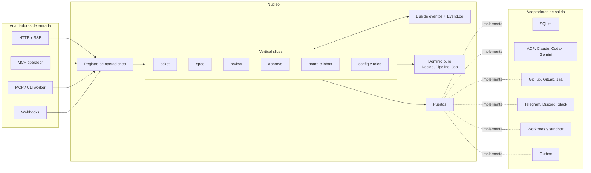

# factoryd: arquitectura hexagonal + vertical slices (Go)

Fecha: 2026-11-05. Decisión de Pablo: factoryd se organiza con arquitectura hexagonal (puertos y adaptadores) y vertical slices.

## Idea
- **Hexagonal** responde *qué depende de qué*: el núcleo (dominio + casos de uso) no conoce GitHub, Telegram, SQLite, ACP ni Claude. Todo eso entra por **puertos** (interfaces) y se implementa en **adaptadores**.
- **Vertical slices** responde *cómo se agrupa el código*: por funcionalidad (ticket, spec, review, approve, config, board…), no por capa técnica. Cada slice tiene su comando o consulta, su handler, sus tests y los puertos angostos que necesita.
- **Núcleo funcional, cáscara imperativa**: la máquina de estados es una función pura `Decide(job, evento, pipeline) → eventos` (cambios de estado y efectos pedidos, como "correr rol X" o "comentar en el PR"). Los slices guardan esos eventos y los efectos se ejecutan a través de puertos. Eso hace testeable todo el flujo sin red, sin agentes y sin base.

## Estructura
```text
factoryd/
├── cmd/
│   ├── factoryd/          # serve: arma todo y arranca (sin cgo)
│   ├── factory/           # CLI operador + worker + `top` (TUI): cliente de la API
│   └── factory-desktop/   # Wails, build aparte (cgo)
├── internal/
│   ├── domain/            # puro, sin IO: Job, Stage, Pipeline, Role, Kind, Result,
│   │   │                  # Finding, Origin, Subscription, Policy, Event
│   │   └── decide/        # máquina de estados genérica (Decide)
│   ├── ports/             # interfaces de salida compartidas
│   │   ├── store.go       # JobStore, EventLog
│   │   ├── agents.go      # AgentRunner, Session
│   │   ├── workspace.go   # Workspace, Sandbox, DevServers
│   │   ├── integrations.go# EventSource, Channel, Tracker, CodeHost
│   │   └── misc.go        # Outbox, Secrets, Clock, Bus
│   ├── slices/            # una carpeta por funcionalidad
│   │   ├── ticket/        # Trigger → job (allowlist, dedupe, hilo, issue espejo)
│   │   ├── intake/
│   │   ├── spec/          # + specgate
│   │   ├── build/         # + gate determinista
│   │   ├── review/        # fan-out por rol, when/modo, veredicto, memoria de hallazgos
│   │   ├── approve/
│   │   ├── merge/         # SHA revisado, checks sin agente
│   │   ├── feedback/      # suscripciones multi-hilo, reanudar
│   │   ├── inbox/         # consulta "te necesita"
│   │   ├── board/         # consulta kanban (columnas desde el pipeline)
│   │   ├── config/        # validate, plan, apply, sync
│   │   ├── roles/         # alta de roles y pipelines
│   │   └── stats/
│   ├── platform/          # transversal sin negocio: bus de eventos, scheduler,
│   │                      # registro de operaciones, logging, OTel
│   ├── adapters/
│   │   ├── in/            # quién llama al núcleo
│   │   │   ├── httpapi/   # REST + SSE (operador y lectura)
│   │   │   ├── mcpoperator/
│   │   │   ├── mcpworker/ # + `factory worker` vía HTTP
│   │   │   └── webhooks/  # GitHub, GitLab…
│   │   └── out/           # a quién llama el núcleo
│   │       ├── sqlite/
│   │       ├── acp/       # AgentRunner genérico
│   │       ├── gitworktree/ sandbox/
│   │       ├── github/ gitlab/ jira/   # Tracker, CodeHost, EventSource, Channel
│   │       ├── telegram/ discord/ slack/
│   │       ├── outbox/
│   │       └── secrets/
│   └── wiring/            # único lugar que importa todo: arma la familia según config
└── ui/
    ├── tui/               # Bubble Tea, solo lectura
    └── web/               # frontend del desktop (go:embed)
```

## Reglas de dependencia (se chequean en CI)
| Paquete | Puede importar | No puede importar |
|---|---|---|
| `domain` | stdlib | todo lo demás |
| `ports` | `domain` | slices, adapters |
| `slices/*` | `domain`, `ports`, `platform` | **otros slices**, adapters |
| `adapters/*` | `domain`, `ports`, `platform`, librerías externas | slices |
| `wiring` | todo | — |
| `cmd/*` | `wiring` (o solo el cliente HTTP, en la CLI) | — |
| `ui/*` | cliente de la API | `internal/*` salvo tipos públicos de la API |

- Se fuerzan con `depguard` (golangci-lint) o `go-arch-lint`; un import prohibido rompe el build.
- **Interfaces del lado del consumidor**: cada slice declara en su `ports.go` solo los métodos que usa (ej. `review` pide `RunRole`, no todo `AgentRunner`). `ports/` tiene las interfaces compartidas; los adaptadores las cumplen sin saber de slices.

## Cómo se hablan los slices
- **Nunca se llaman directo.** Publican y escuchan eventos de dominio en el bus de `platform`: `StageCompleted`, `ReviewVerdict`, `HumanReplied`, `ConfigApplied`…
- El evento se guarda en el `EventLog` antes de despacharse (misma transacción que el cambio de estado): si factoryd se cae, al volver reprocesa lo pendiente.
- Efectos externos (comentar, push, PR, mensaje a Telegram) van siempre al **outbox**, nunca directo desde un slice.

## Una operación, todos los canales
Cada slice registra sus operaciones en un **registro de operaciones** (`platform/ops`): nombre, schema de entrada y salida, si es sensible y su handler. Los adaptadores de entrada las exponen solas:
- HTTP (`POST /ops/job.approve`), MCP operador (tool `job_approve`), CLI (`factory approve`), botones de Telegram/Discord.
- Lo sensible (approve, merge, config apply, role add) exige confirmación humana en todos los canales por igual.
- Agregar una operación = tocar un slice; ningún adaptador cambia.

```go
// slices/approve/op.go
func Register(r *ops.Registry, h *Handler) {
    r.Add(ops.Op[ApproveInput, ApproveOutput]{
        Name:      "job.approve",
        Sensitive: true,               // pide confirmación humana
        Scope:     ops.ScopeOperator,  // nunca con token de job
        Handle:    h.Handle,
    })
}

// slices/approve/handler.go
type jobs interface {               // puerto angosto, del lado del consumidor
    Load(ctx context.Context, id domain.JobID) (domain.Job, ports.Version, error)
    // corre decide.Decide sobre el job guardado en v y guarda estado + sus eventos
    // en una transacción; solo guarda eventos de Decide, nunca ev
    Apply(ctx context.Context, id domain.JobID, v ports.Version, p domain.Pipeline, ev domain.Event, acts ...ports.Action) ([]domain.Event, ports.Version, error)
    // acts: efectos externos (comentar, push…) que se guardan en el outbox en la misma transacción
}

type Handler struct{ Jobs jobs; Pipelines pipelines; Clock ports.Clock }

func (h *Handler) Handle(ctx context.Context, in ApproveInput) (ApproveOutput, error) {
    j, v, err := h.Jobs.Load(ctx, in.JobID)
    if err != nil { return ApproveOutput{}, err }
    p, err := h.Pipelines.For(j)
    if err != nil { return ApproveOutput{}, err }
    ev := domain.HumanApproved{Job: j.ID, By: in.Actor, WaitSeq: in.WaitSeq, At: h.Clock.Now()}
    _, _, err = h.Jobs.Apply(ctx, j.ID, v, p, ev) // ej. el job no está esperando aprobación, o ports.ErrVersionConflict
    return ApproveOutput{Job: j.ID}, err
}
```

## Tests
Con **go-specs** (`github.com/getsyntegrity/go-specs`, versión fija): `Describe`/`When`/`It`, `specs.Table` para tablas de casos, shared behaviors para las suites de contrato, fuzzing nativo de Go para invariantes de `Decide` y `snapshots` para salidas estables. Detalle en `AGENTS.md`.

| Nivel | Qué | Cómo |
|---|---|---|
| Dominio | `Decide` y reglas | `specs.Table` sin mocks + fuzzing de invariantes; aquí van los tests portados |
| Slice | handler + evento | fakes en memoria de sus puertos angostos |
| Contrato de adaptador | que cada adaptador cumpla su puerto | una shared behavior de go-specs por puerto, corrida contra cada adaptador y su fake |
| Punta a punta | ticket → merge | repo fixture, code host falso, agente ACP falso que responde con guiones |

## Diagrama


## Orden de construcción
1. `domain` + `decide` con los tests portados (todo puro).
2. `ports` + adaptadores en memoria (para tests) + `sqlite`.
3. Slices del camino feliz: `ticket` → `spec` → `build` → `review` → `approve` → `merge`, con el adaptador ACP y un agente.
4. `platform/ops` + `httpapi` + CLI.
5. Adaptadores de GitHub y Telegram; luego `mcpoperator`, `board`, `inbox`.
6. Linter de dependencias en CI desde el día 1.
