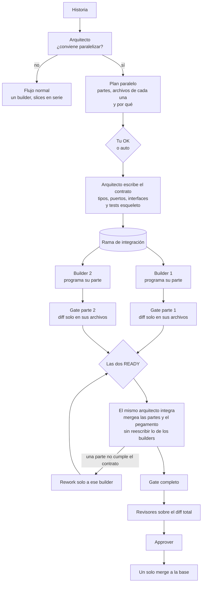

# factoryd: una historia en paralelo (arquitecto + builders)

Fecha: 2026-11-06. Idea de Pablo: que la fábrica pueda decir "esta historia la encaramos con dos programadores y un integrador", y que el que arma el contrato sea el mismo que integra.

## Roles
- **Arquitecto**: un agente que decide si conviene paralelizar, escribe el **contrato** (tipos, puertos, interfaces y tests esqueleto) y, cuando las partes están listas, las **integra**. Es la misma sesión de principio a fin: se reanuda si el agente lo soporta y, si no, retoma con su propio `contract.md` como traspaso.
- **Builders** (dos o más): cada uno programa una parte contra el contrato, en su worktree, tocando solo los archivos de su parte.
- Después, todo sigue igual que en un job normal: gate completo, revisores sobre el diff total, approver y **un solo merge** a la base.

## Cuándo conviene
El arquitecto propone paralelizar solo si se cumplen las tres:
1. Las partes escriben archivos distintos (en esta arquitectura suele pasar: dominio, adaptador y slice viven en paquetes separados).
2. Se puede fijar un contrato antes, sin que dependa de lo que cada parte descubra.
3. La historia es grande: en una chica, coordinar cuesta más de lo que ahorra.

Si no, sigue el flujo normal. El plan (partes, archivos de cada una, por qué) se muestra para tu OK, o arranca solo con `auto`.

## Reglas
- El gate de cada parte rechaza un diff fuera de sus archivos; el del contrato, uno que agregue lógica más allá de tipos, firmas y tests esqueleto.
- Al integrar, el arquitecto solo escribe el pegamento (wiring, imports, adaptaciones mínimas). Si una parte no cumple el contrato, no la reescribe: le manda un rework solo a ese builder.
- El arquitecto no revisa su propio trabajo: los revisores ven el diff total con el contrato marcado, para que un contrato mal diseñado no pase porque "todo encaja".
- Costo: cada builder carga su contexto, así que gasta más tokens y menos tiempo de reloj. Los topes de #103 cuentan todo el trabajo de la historia. Una historia en paralelo ocupa tantos slots de concurrencia como builders.
- Solo factoryd: la fábrica actual no tiene rama de integración ni integrador.

## Diagrama

